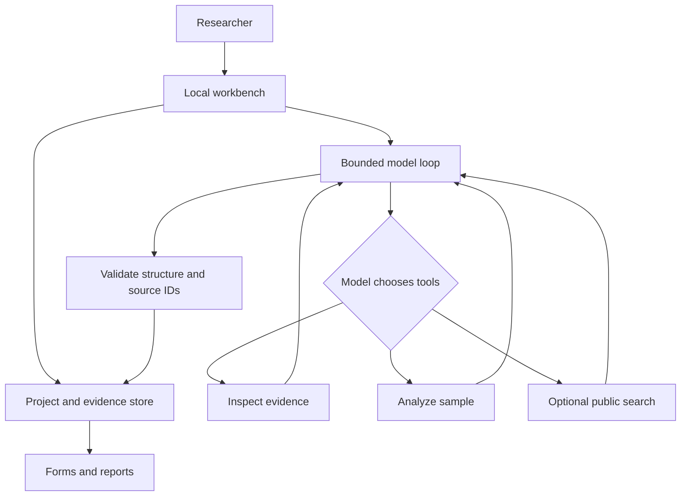

# Architecture & validation

Python 3.9+ standard library backend, SQLite local persistence, plain HTML/CSS/JS. No SDK or build dependency. Static preview is generated separately from curated public data.

## Contracts

- `research/domain.py`: project contract, research plan, portable form schema, consent-aware sample analysis, provenance validation and exports.
- `research/agent.py`: Chat Completions tool loop; maximum 6 model rounds by default, 3 searches, 8 tool requests per model turn, 6500 output tokens per request. Checks elapsed time between requests; individual network timeout45 seconds. The 240-second budget is cooperative and can be exceeded by an in-flight request. Not a currency cap.
- `research/store.py`: local SQLite project JSON, parameterized queries.
- `app.py`: loopback-only HTTP; write lock serializes mutations; origin/host checks reject browser cross-site writes. No cloud auth or public hosting support.
- `web/`: local UI; user-entered text is escaped, no HTML/Markdown execution.
- `scripts/build_demo.py`: only imports curated seed data, never reads research database or environment secrets.

## Provenance

Source ID validation checks that an ID exists; it cannot establish semantic entailment. A correct-looking reference may still be irrelevant, old, biased or contradict the claim. Human review is a required research step.

New searches are stored as unverified excerpts, not fetched full pages. Search-generated or imported text is untrusted input, and the model is instructed to ignore embedded instructions. Tool permissions do not include code execution, arbitrary URL fetching, credential reading, messaging or publishing.

No-consent responses are excluded before storage and analysis. Duplicate anonymous participant IDs reject the whole import; no silent overwrite. Valid responses become evidence entries, making their qualitative answers inspectable by the model. Different responses from the same team count once toward distinct known teams. This is not deduplication across unknown or inconsistent organization aliases.

## Validation scope

Automated tests cover core research failure modes: fabricated seed fieldwork, unsupported certainty, invalid source IDs, missing values, sample units, duplicate participants, negative savings, invalid numbers, untrusted export content, persistence, absent credentials and mocked tool execution.

In-memory HTTP handler integration tests verify endpoint routing, persistence, consent handling and exports without opening a network port. The implementation environment blocks loopback socket binding, so a live HTTP server/browser integration was not completed there. Live provider credentials were not present: real model/search compatibility, relevance and answer quality remain unverified. Run a small public-data-only pilot with your own provider before importing fieldwork.

Not implemented: survey cloud collection, public API deployment, account management, multi-user authorization, full-text crawling, automatic transcription, causal inference, representative sampling, automatic semantic verification, monetary cost accounting or third-party cloud-model reliability evaluation.
